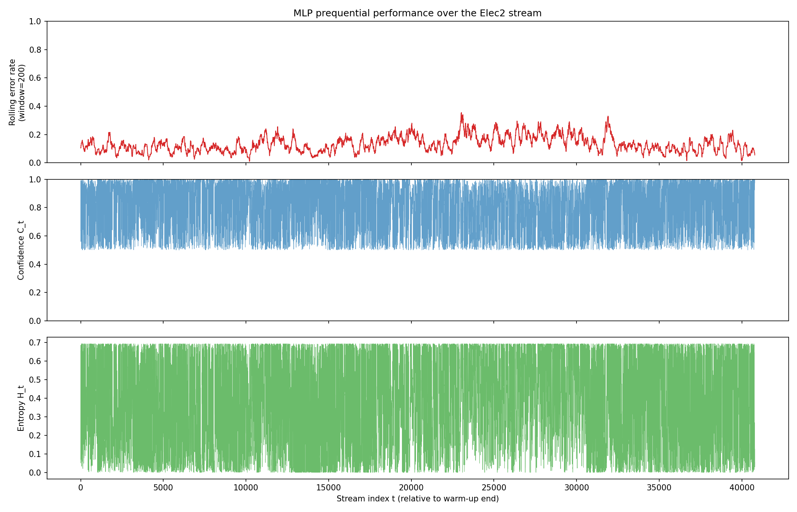
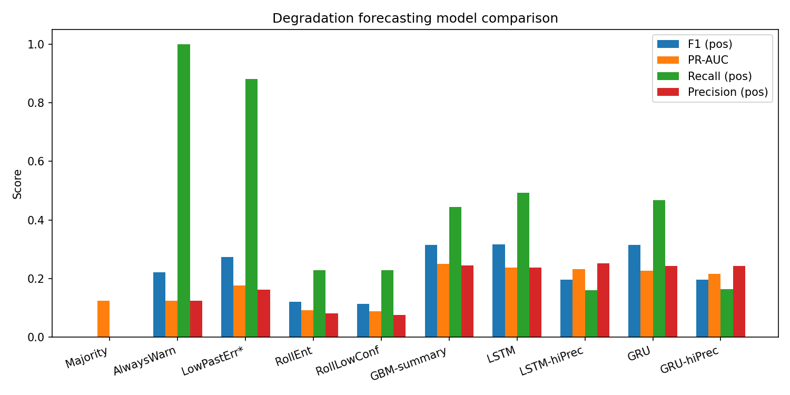
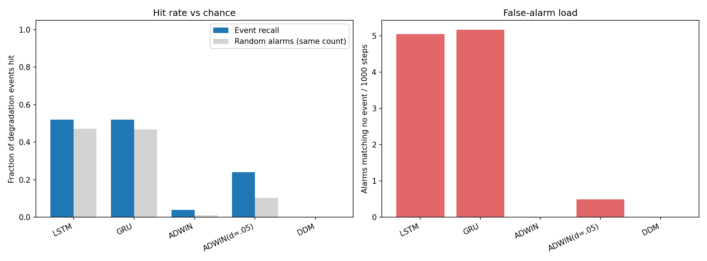
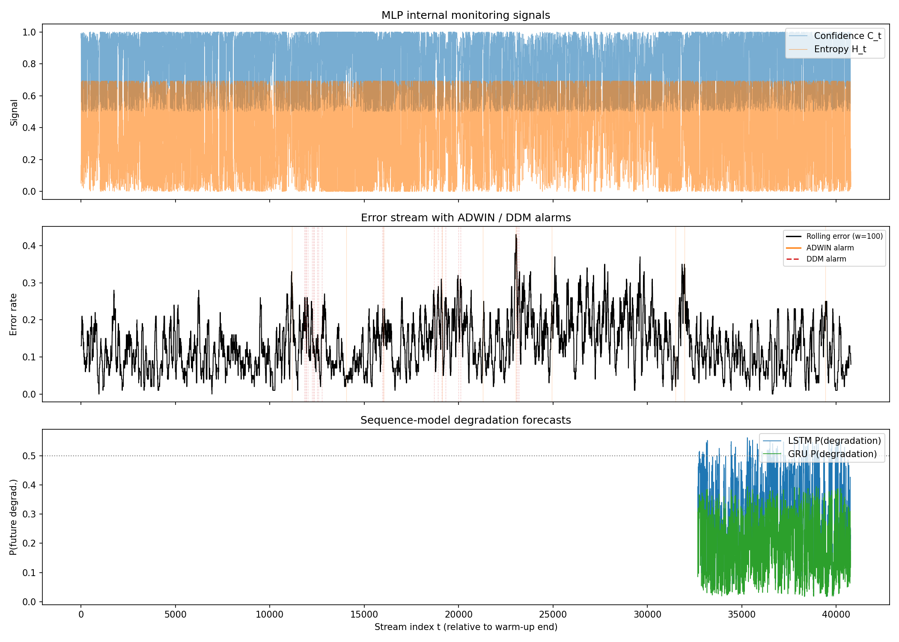
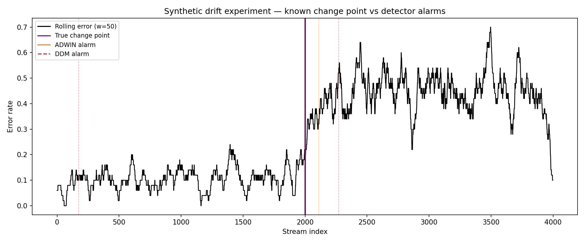

# Early Detection of Concept Drift and Model Degradation Using Deep Sequence Models

## Abstract

We ask whether the internal signals of a deployed classifier, namely its prediction confidence and entropy, let a sequence model *forecast* an upcoming rise in the classifier's error rate before error-based drift detectors (ADWIN, DDM) react. A NumPy MLP runs prequentially (test-then-train) over the Elec2 electricity stream (45,312 samples). NumPy LSTM and GRU models with hand-written, gradient-checked backpropagation read 20-step windows of confidence and entropy. They predict whether the error rate over the next 20 steps will exceed the previous 20 by more than 0.15.

On the held-out test split (positive rate 0.125), the LSTM reaches PR-AUC 0.238, F1 0.317 and precision 0.237, roughly twice chance. The GRU and a gradient-boosting model on hand-crafted window summaries perform the same, so the recurrent architecture adds nothing measurable here. At the event level, the forecasters catch 52% of severe degradation events against 47% for the same number of random alarms, so **early warning is not demonstrated**. A follow-up experiment chose a longer reference window for the label on validation data (R = 100), but it did not improve the test results.

---

## 1. Research question

Concept drift detectors such as ADWIN and DDM monitor the stream of prediction *errors*. Errors need ground-truth labels and accumulate slowly, so these detectors are reactive by design. A deployed model's own output distribution (confidence, entropy) is available immediately and without labels. The question is:

> Can a sequence model reading the MLP's confidence/entropy history predict an imminent increase in error rate, and raise an alarm earlier than ADWIN/DDM?

## 2. Data and setup

**Data.** Elec2 (NSW electricity market), 45,312 half-hourly samples, 8 numeric features, binary target (price up/down). The data has well-known real drift.

**Base classifier.** A NumPy MLP (64 hidden units, dropout 0.2). It is warm-up trained offline on the first 10% of the data (4,531 samples) and then run prequentially over the remaining 90%: it predicts each sample and then updates on it. This produces per-step confidence, entropy and a 0/1 error signal. Features are scaled causally: row *t* uses the mean and standard deviation of rows before *t* only, clipped at ±5σ.

**Windows and label.** For a prediction time *t*:

- input: `[confidence, entropy]` over `[t−20, t)`, strictly past data;
- label: `1` if `mean(err[t : t+20]) − mean(err[t−20 : t]) > 0.15`, else `0`.

The windows are split 60/20/20 by window position, with 40-step gaps so that no label region overlaps the next split's inputs:

| Split | Windows | Positive rate |
|---|---|---|
| Train | 24,448 | 0.142 |
| Validation | 8,116 | 0.190 |
| Test | 8,097 | 0.125 |

**Forecasters.** NumPy LSTM and GRU cells (hidden size 32) with a logistic readout, trained by per-sample SGD for 8 epochs (lr 0.002, decay 0.75 per epoch) with half-strength class weighting (`pos_weight = ((1−p)/p)^0.5 ≈ 2.46`), using 3 seeds each. Analytic gradients match numerical gradients (max relative error < 1e−6). The epoch is chosen by validation PR-AUC and the decision threshold by validation F1. All hyperparameters were chosen on validation only, and the test split was evaluated once.

**Baselines.**
- *Majority* (never warn) and *always warn*.
- *Low past error\**: warn when the error rate in the last 20 steps was low. This needs ground-truth labels and is a mean-reversion reference.
- *Rolling entropy* and *rolling low confidence*: window mean, with the threshold tuned on validation.
- *Gradient boosting on window summaries*: a non-neural reference using 9 hand-crafted features (mean, std, min and recent trend of confidence and entropy).
- *ADWIN* (default δ and δ = 0.05) and *DDM* from `river`, run on the error stream.

## 3. Results

### 3.1 Base classifier (Table A)

On the test stream the MLP reaches accuracy 0.893, F1 0.884, ROC-AUC 0.953 and PR-AUC 0.944. Prequential accuracy over the whole monitored stream is 0.868. The base model is therefore strong, and degradation episodes are short-lived departures from roughly 11–13% error.



### 3.2 Degradation forecasting (Table B, test split)

| Model | Precision | Recall | F1 | PR-AUC | Accuracy |
|---|---|---|---|---|---|
| Majority (never warn) | 0.000 | 0.000 | 0.000 | 0.125 | 0.875 |
| Always warn | 0.125 | 1.000 | 0.222 | 0.125 | 0.125 |
| Low past error\* | 0.162 | 0.881 | 0.274 | 0.177 | 0.418 |
| Rolling entropy | 0.082 | 0.228 | 0.121 | 0.093 | 0.586 |
| Rolling low confidence | 0.076 | 0.228 | 0.114 | 0.090 | 0.556 |
| Gradient boosting (summaries) | 0.245 | 0.445 | 0.316 | 0.250 | 0.760 |
| **LSTM** (3 seeds) | 0.237 ± 0.010 | 0.494 | 0.317 ± 0.013 | 0.238 ± 0.004 | 0.736 |
| LSTM, high-precision point | 0.252 | 0.161 | 0.197 | 0.233 | 0.836 |
| **GRU** (3 seeds) | 0.243 ± 0.013 | 0.468 | 0.315 ± 0.013 | 0.227 ± 0.008 | 0.749 |
| GRU, high-precision point | 0.244 | 0.165 | 0.197 | 0.216 | 0.832 |

\* uses ground-truth labels of the recent past; the other rows use only the MLP's internal signals. The high-precision rows use the validation threshold with the best precision subject to recall ≥ 0.25.



Findings:

- **There is real but modest skill.** PR-AUC is about 0.24 against a base rate of 0.125, about 1.9× chance. F1 is 0.32, which beats always-warn (0.22) and the label-based low-past-error score (0.27).
- **Simple aggregates of the signals are not enough.** Rolling entropy and rolling confidence score *below* chance (PR-AUC about 0.09). The useful information is in the window's shape and trend, which both the recurrent models and the gradient-boosting summaries capture.
- **The recurrent models give no measurable advantage.** LSTM and GRU are within seed noise of each other and of gradient boosting.
- **Precision can be traded for recall.** At the high-precision operating point, accuracy rises to 0.84 and precision to 0.25, but recall falls to 0.16.
- The positive-rate shift across splits (0.142 / 0.190 / 0.125) means thresholds tuned on validation transfer imperfectly to test.

### 3.3 Signal ablation (LSTM, 3 seeds, test split)

| Inputs | F1 | PR-AUC |
|---|---|---|
| Confidence only | 0.298 ± 0.002 | 0.287 ± 0.010 |
| Entropy only | 0.287 ± 0.008 | 0.230 ± 0.040 |
| Confidence + entropy | 0.317 ± 0.013 | 0.238 ± 0.004 |

Using both signals gives the best F1, while confidence alone gives the best PR-AUC. For a two-class model, confidence and entropy are deterministic functions of each other, so this is a difference in input representation, not in information. With 3 seeds the ablation does not clearly favour either variant. We did not select a variant on test.

### 3.4 Early warning against ADWIN/DDM (Table D, test stream)

*Severe events* are onsets where the next-20-step error rate exceeds the previous-20-step rate by more than 0.30, merged within 40 steps; the test stream has 25 of them. An alarm *hits* an event if it falls within `[onset − 30, onset + 60]`. LSTM and GRU raise an alarm when their output exceeds the 95th percentile of their own previous 2,000 outputs, a causal rule. *Chance* is the expected recall of the same number of random alarms.

| Method | Alarms | Event recall | Chance | Warned before onset | Median offset | False alarms / 1000 |
|---|---|---|---|---|---|---|
| LSTM | 59 | 0.52 | 0.47 | 0.28 | −3 | 5.1 |
| GRU | 58 | 0.52 | 0.47 | 0.20 | +2 | 5.2 |
| ADWIN | 1 | 0.04 | 0.01 | 0.04 | −28 | 0.0 |
| ADWIN (δ = 0.05) | 10 | 0.24 | 0.10 | 0.04 | +38 | 0.5 |
| DDM | 0 | 0.00 | 0.00 | 0.00 | n/a | 0.0 |



- **Early warning is not demonstrated.** The forecasters hit 13 of 25 events, while random alarms at the same rate would be expected to hit about 12. With 25 events this difference is well within noise.
- **ADWIN and DDM barely fire on this test stream.** Episodes of about 20 steps are too short and too small for them. When the more sensitive ADWIN (δ = 0.05) does fire, it is well above chance (0.24 vs 0.10) but late, with a median of 38 steps after onset. That fits its role as a reactive detector.
- The two approaches answer different questions. The forecasters fire often and cheaply on short fluctuations, while ADWIN/DDM fire rarely, on sustained shifts.



### 3.5 Synthetic benchmark (Table C)

On synthetic error streams with one known change point (error 0.10 → 0.45), ADWIN detected every change with a delay of 47–111 steps and no false alarms. DDM detected every change with a delay of 112–270 steps and raised one false alarm on a stationary stream. The detectors work as expected on sustained, large shifts. Their silence on Elec2 reflects the kind of degradation in that stream, not a broken implementation.



### 3.6 Follow-up: a longer reference window for the label

The label compares the next 20 steps with the previous 20, so part of what it rewards is *mean reversion*: after a low-error stretch the error rate tends to rise. The label-based "low past error" score already reaches PR-AUC 0.177. We added `reference_len = R`, which compares the next 20 steps with `mean(err[t−R : t])`.

**Protocol (validation only, rule fixed before running).** Each R was scored by `(AP_LSTM − AP_LowPastErr*) / positive rate`, which measures skill beyond mean reversion in base-rate units. Scores were computed on the odd validation windows, because the even ones are used for early stopping, with 2 seeds per R. The rule was to keep R = 20 unless another R beat it by more than the seed spread.

| R | Val pos. rate | LSTM AP | LowPastErr\* AP | GBM AP | Skill |
|---|---|---|---|---|---|
| 20 (original) | 0.188 | 0.401 ± 0.016 | 0.337 | 0.406 | 0.342 ± 0.083 |
| **100** | 0.170 | 0.312 ± 0.007 | 0.235 | 0.329 | **0.454 ± 0.043** |
| 500 | 0.161 | 0.260 ± 0.005 | 0.218 | 0.260 | 0.259 ± 0.032 |
| 2000 | 0.165 | 0.218 ± 0.009 | 0.202 | 0.255 | 0.096 ± 0.057 |

R = 100 was selected, though its gain (+0.111) only just exceeds the seed spread (0.083). The full pipeline was then run **once** on test with R = 100:

| Test split | R = 20 (main) | R = 100 |
|---|---|---|
| Low past error\* PR-AUC | 0.177 | 0.176 |
| Gradient boosting PR-AUC / F1 | 0.250 / 0.316 | 0.207 / 0.281 |
| LSTM PR-AUC / F1 / precision | 0.238 / 0.317 / 0.237 | 0.233 / 0.303 / 0.221 |
| GRU PR-AUC / F1 / precision | 0.227 / 0.315 / 0.243 | 0.193 / 0.269 / 0.212 |
| LSTM skill beyond mean reversion | 0.49 | 0.46 |
| Early warning: LSTM recall vs chance | 0.52 vs 0.47 (25 events) | 0.57 vs 0.45 (23 events) |
| Early warning: GRU recall vs chance | 0.52 vs 0.47 | 0.52 vs 0.55 |

**This is a negative result.** On validation the longer reference weakened the mean-reversion baseline, with its lift falling from 1.79 to 1.38. On test that baseline is unchanged, and no model improved; the GRU and gradient-boosting models got worse. The validation gain did not transfer, which is consistent with it being only marginally above seed noise. The main results therefore use the original label.

### 3.7 Our detector: RiskGate-CUSUM

The forecasters alone fire too often (Section 3.4), and the error-based tests are reliable but late. **RiskGate-CUSUM** (`src/riskgate.py`, details in `README_NOVELTY.md`) combines them inside one sequential test. A one-sided CUSUM runs on the MLP's error stream, and the GRU forecaster's risk, converted to a causal percentile rank `u_t`, changes it in two ways:

```
S_t = max(0, S_(t-1) + (e_t - mu_t - k) + gamma * max(0, u_t - u0))    evidence injection
alarm when S_t > h_t,   h_t = h0 * (1 - beta * u_t)                    threshold gating
```

With `beta = gamma = 0` it is the plain CUSUM, which is the existing baseline it is compared with. Each variant was tuned on the validation stream (event F1 with at most 6 alarms per 1,000 steps) and evaluated once on the 25 test events of Table D, with one forecaster seed:

| Method | Alarms | Event recall | Alarm precision | Event F1 | Median offset | False alarms / 1000 |
|---|---|---|---|---|---|---|
| CUSUM (plain) | 26 | 0.80 | 0.88 | 0.840 | +21 | 0.4 |
| **RiskGate-CUSUM** | 25 | 0.80 | 0.96 | **0.873** | +19 | 0.1 |
| Forecaster only | 63 | 0.60 | 0.30 | 0.401 | −6 | 5.4 |
| Naive OR (CUSUM + forecaster) | 83 | 0.84 | 0.46 | 0.593 | +7 | 5.6 |
| ADWIN (δ = 0.05) | 10 | 0.24 | 0.60 | 0.343 | +38 | 0.5 |

RiskGate has the best event F1, through fewer false alarms. The difference from plain CUSUM is about one alarm, from one seed and 25 events, so it is **not statistically meaningful**. It does not warn earlier: every CUSUM variant fires about 20 steps after onset. Fusing inside the test is clearly better than simply OR-ing the two alarm streams. ADWIN and DDM were not tuned on validation, so this table favours the CUSUM family.

### 3.8 Demo: injected drift with a known answer

`src/demo.py` replays the whole system on the test stream and injects drift of a known type and size at test step 4,000. The scenarios are sudden or gradual concept drift (the up/down rule reverses during 10, 25 or 50% of the day's half-hour slots) and a feature shift (price inputs +1 or +2.5 standard deviations). It then compares the 2,000 steps before and after. The verdict is **Drift** when the error rate rose significantly, by at least 5 percentage points, and ADWIN or DDM confirmed it; **No drift** when there was no significant rise, an estimate under 5 pp, and no alarm; and **Uncertain** otherwise.

| Scenario | Verdict | Accuracy | ADWIN / DDM delay | CUSUM / RiskGate alarms (before → after) |
|---|---|---|---|---|
| No drift (real stream) | No drift | 90.6% → 88.5% | none | 5 → 8 / 5 → 8 |
| Sudden, 10% | Drift (mild) | 90.6% → 83.5% | +255 / +761 | 5 → 7 / 5 → 6 |
| Sudden, 25% | Drift (moderate) | 90.6% → 79.2% | +95 / +250 | 5 → 14 / 5 → 14 |
| Sudden, 50% | Drift (moderate) | 90.6% → 72.2% | +63 / +92 | 5 → 17 / 5 → 18 |
| Gradual, 10% | Drift (mild) | 90.6% → 85.1% | +1,151 / +1,141 | 5 → 8 / 5 → 9 |
| Gradual, 25% | Drift (mild) | 90.6% → 82.0% | +255 / +859 | 5 → 8 / 5 → 10 |
| Gradual, 50% | Drift (moderate) | 90.6% → 76.4% | +255 / +570 | 5 → 19 / 5 → 17 |
| Feature shift, +1σ | Uncertain | 90.6% → 87.1% | none | 5 → 6 / 5 → 9 |
| Feature shift, +2.5σ | Uncertain | 90.6% → 86.2% | none / +1,561 | 5 → 4 / 5 → 5 |

Every injected concept drift is detected, and the accuracy loss grows with its size. ADWIN is faster than DDM except in the weakest gradual case. On strong sudden drift the CUSUM family fires first (50%: RiskGate +5 steps, CUSUM +7), but it also fires on natural error spikes, so it complements ADWIN/DDM rather than replacing them. The LSTM forecaster's alarm rate does not rise under drift, while the MLP's confidence does drop (from 0.865 to 0.735 at 50% sudden drift).

## 4. Discussion

**What the evidence supports.** A deployed classifier's confidence and entropy carry some information about whether its error rate is about to rise, about twice chance precision. This information is in the short-term dynamics of the signals, not their level.

**What it does not support.**
1. *Deep sequence models are not shown to be needed.* A shallow tree ensemble on nine window summaries matches the LSTM and GRU.
2. *Early warning ahead of ADWIN/DDM is not shown.* At the event level the forecasters are indistinguishable from random alarms at the same rate. ADWIN/DDM are not a strong comparison here either, because they almost never fire on Elec2's short degradation episodes. Using the forecaster inside a CUSUM (RiskGate) makes its signal useful for precision, not for earlier alarms.
3. *The label partly measures mean reversion.* A label-based heuristic gets part of the way, and a longer reference window, chosen properly on validation, did not fix this on test.

**Limitations.**
- There is one dataset and one base classifier.
- The test set contains only 23–25 severe events, so event-level comparisons have very little statistical power.
- The positive rate shifts between splits.
- 3 seeds in the main run and 2 in the label experiment give rough variance estimates.
- Signal-only forecasting cannot tell "the model is uncertain" apart from "the data is hard right now".

**Earlier version.** The first version of this pipeline was invalid. The MLP warm-up used 60% of the stream, which left only about 20 training windows for the forecasters. A rolling-entropy baseline was also tuned on the test labels using a centred, future-seeing window. With the fixes, test F1 went from 0.24 to 0.32, precision from 0.14 to 0.24 and accuracy from 0.42 to 0.74. The README "Fix log" lists every change.

**Next steps.**
1. An absolute error-rate label, such as "error over the next 50 steps exceeds the long-run rate by k standard deviations", which matches ADWIN's view better.
2. Longer forecasting horizons with more events, or several drift datasets, to give the event-level test real power.
3. Feeding the forecaster's alarms to the MLP as an adaptation trigger (for example a learning-rate bump), and measuring the downstream accuracy instead of alarm metrics.

## 5. Conclusion

With a correctly split training set and leakage-free baselines, LSTM and GRU forecasters reading the MLP's confidence and entropy predict short-horizon degradation at about twice chance precision (PR-AUC 0.24, F1 0.32). They do no better than a gradient-boosting reference, and they do not provide earlier warning than random alarms at the event level. A validation-chosen change to the label did not improve this. Our RiskGate-CUSUM, which feeds the forecaster's risk into a CUSUM test, gives the best event-level F1 (0.87 vs 0.84 for plain CUSUM), but the margin is about one alarm and not statistically meaningful. In the controlled demo, every injected concept drift is detected and its size is measured correctly. The honest answer to the research question on Elec2 is: **some signal, no demonstrated early-warning advantage.**

## Reproducibility

```bash
pip install -r requirements.txt
python -m pytest tests/ -v                 # 74 tests
python -m src.gradcheck                    # LSTM/GRU gradient check
python -m src.train                        # main results (R = 20), ~11-25 min
python -m src.label_experiment             # label experiment, validation only, ~20 min
python -m src.train --reference-len 100    # R = 100 test run
python -m src.report                       # print tables from results/
python -m src.novelty_experiment --seeds 1 # RiskGate-CUSUM, ~4-8 min
python -m src.demo                         # demo data, then open demo/index.html
```

Snapshots of the results: `docs/results/` (main run), `docs/results/label_experiment/` (label experiment and R = 100 run) and `docs/novelty/` (RiskGate-CUSUM). Seeds 0–2; one CPU core; Python 3.13, NumPy, scikit-learn, river 0.26.
